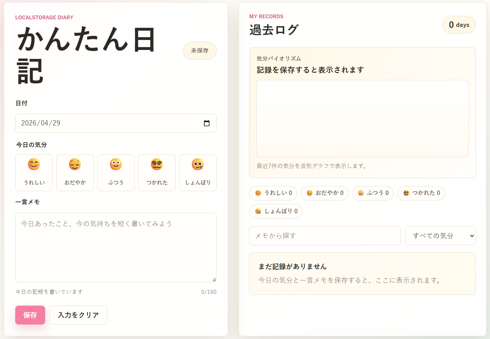

# 学習ログ

HTML/CSS/JavaScriptとlocalStorageだけで動く、学習記録アプリです。

日付ごとに学習テーマ、学習時間、学習の手応え、学んだことを保存できます。保存した記録はブラウザのlocalStorageに残るため、ページを閉じても同じブラウザで過去の学習を振り返れます。

## 📱 デモ

🔗 [https://gigaschool.github.io/tiny-diary/](https://gigaschool.github.io/tiny-diary/)



## デモの動かし方

`index.html` をブラウザで開くだけで使えます。ビルドやサーバー起動は不要です。

```text
my-study-log/
├── index.html
├── styles.css
├── app.js
├── README.md
└── LICENSE
```

## 機能

- 今日の日付を自動セット
- 学習テーマと学習時間を記録
- 学習の手応えを5種類から選択
- 学んだことや気づきを保存
- 日付ごとに1件の記録として保存
- 同じ日付で保存すると上書き
- 学習記録と合計学習時間の表示
- 保存済みログの編集
- 保存済みログの削除
- テーマや学んだことの検索
- 学習の手応えによる絞り込み
- 最近7件の学習の手応えを波形グラフで表示

## 使用技術

- HTML
- CSS
- JavaScript
- localStorage

外部ライブラリは使っていません。

## localStorage

保存キーは `tiny-diary.entries.v1` です。

データは次のような配列で保存されます。

```json
[
  {
    "id": "example-id",
    "date": "2026-04-29",
    "subject": "英語",
    "duration": 30,
    "mood": "happy",
    "note": "新しい単語を10個覚えた",
    "createdAt": "2026-04-29T10:00:00.000Z",
    "updatedAt": "2026-04-29T10:00:00.000Z"
  }
]
```

## 学習の手応え

手応えは次の5種類です。

| 値 | 表示 | スコア |
| --- | --- | --- |
| `happy` | よくできた | 5 |
| `calm` | 理解できた | 4 |
| `normal` | ふつう | 3 |
| `tired` | 復習したい | 2 |
| `sad` | むずかしい | 1 |

学習のふりかえりでは、最近7件の記録をこのスコアに変換して、SVGの波形グラフとして表示します。

## 教材で説明しやすい流れ

1. フォームから値を受け取る
2. JavaScriptの配列に学習記録を追加する
3. `JSON.stringify` でlocalStorageへ保存する
4. `JSON.parse` でlocalStorageから読み込む
5. 配列をもとに一覧と学習のふりかえりを再描画する

## ファイル構成

- `index.html`: 画面の構造
- `styles.css`: レイアウトと見た目
- `app.js`: 保存、表示、編集、削除、検索、学習のふりかえり描画
- `README.md`: この説明ファイル
- `LICENSE`: MITライセンス

## ライセンス

MIT License
